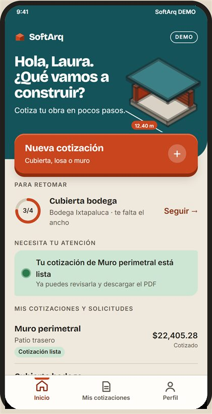
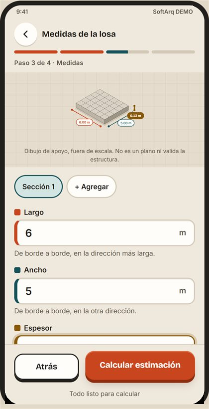
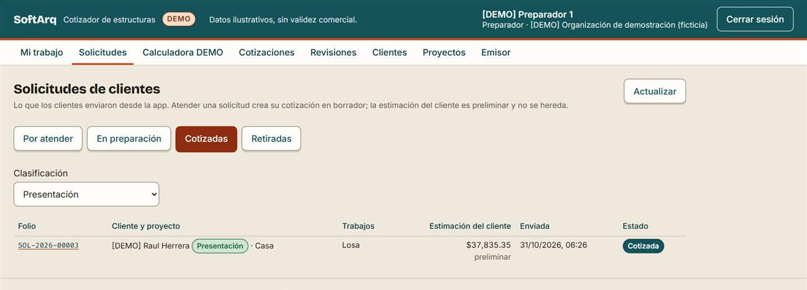
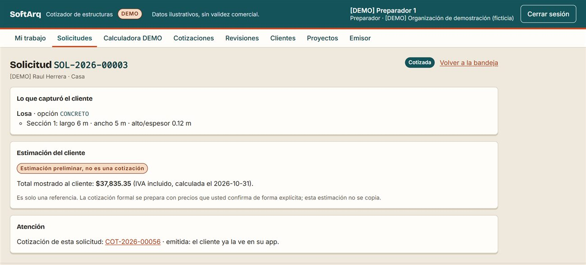
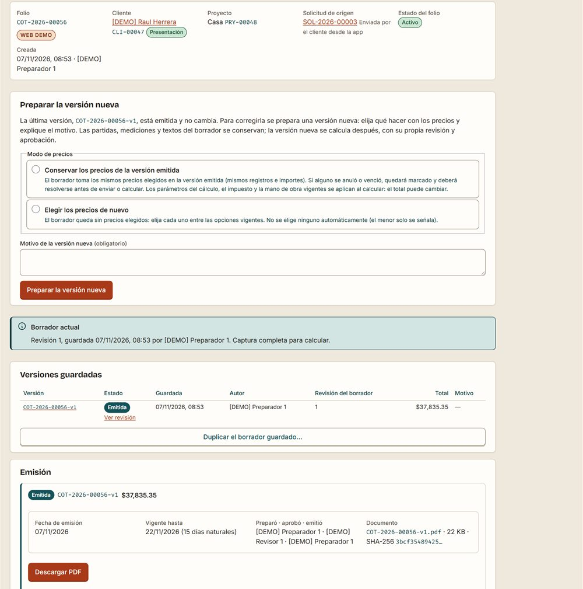
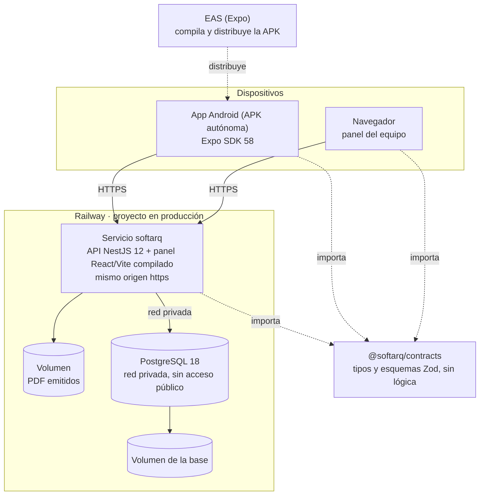

# SoftArq

**SoftArq** es una plataforma para cotizar estructuras de construcción —cubiertas, losas y muros—. Un cliente describe su obra en una app móvil y recibe una estimación preliminar; el equipo atiende la solicitud en un panel web, elige los precios, calcula, revisa, aprueba y emite una cotización formal en PDF.

Sucede al libro de Excel de la fase 1 (`Cotizador_Estructuras_F1.xlsm`) y a su documento maestro, que definieron las reglas de cálculo y de negocio. Esas reglas viven ahora en un único motor de cálculo en la API.

> **Entorno DEMO.** Todos los datos de ejemplo son ficticios y están marcados como DEMO en pantallas y documentos. El sistema no es apto para cotizaciones comerciales reales.

## Qué resuelve

Cotizar una estructura exige medidas, precios vigentes y control. SoftArq separa las tareas por persona y deja constancia de quién hizo qué, con qué precios y cuándo:

- el **cliente** captura su obra y ve una estimación orientativa;
- el **equipo** prepara la cotización formal con precios elegidos de forma explícita;
- una **segunda persona** revisa y aprueba;
- la **emisión** produce un documento inalterable, con folio, vigencia y huella SHA-256.

## Funciones principales

### App del cliente (Android, Expo)

- Acceso con cuenta de cliente (con cambio de la contraseña temporal) y cierre de sesión.
- Proyectos y trabajos (cubierta, losa o muro), medidas con un croquis de apoyo y resumen.
- **Estimación preliminar** calculada por la API, siempre rotulada como no formal.
- Envío de la solicitud al equipo, seguimiento y descarga del PDF de la cotización emitida.
- Solo muestra y captura: no calcula ni decide permisos.

<p>
  
  
</p>

*Vista ilustrativa de la app (identidad «Obra cálida»; nombres y cifras de ejemplo).*

### Panel del equipo (web)

Cada función ve solo sus secciones:

- **Mi trabajo, Solicitudes y Cotizaciones:** bandeja de solicitudes de clientes, borradores, versiones, duplicado y vista previa del PDF.
- **Revisiones:** bandeja del Revisor para aprobar o pedir cambios.
- **Clientes y Proyectos**, con clasificación y filtros.
- **Catálogo:** proveedores, productos, precios con vigencia, mano de obra, insumos, conversiones, conceptos, componentes, tipos de estructura, trabajos para clientes y precios de referencia de la estimación.
- **Administración:** parámetros (recargo, impuesto, vigencia, textos), personas y funciones, y emisor del documento.
- **Mi cuenta:** cada persona cambia su propia contraseña (el servidor guarda solo el hash Argon2id).
- **Vista de presentación:** las listas, la bandeja y los contadores muestran por omisión los ejemplos de presentación; la opción «Todo el historial» (o la clasificación elegida) amplía el alcance sin ocultar nada en el servidor.
- **Exportaciones:** exportación de 15 tablas y manifiesto en CSV (no es una migración completa; la recuperación completa es el respaldo).



## Del pedido a la emisión

1. **Solicitud.** El cliente captura su obra en la app y ve la estimación preliminar. Al enviarla, la estimación no se hereda: es solo una referencia.
2. **Atención.** El Preparador atiende la solicitud desde la bandeja y se crea un borrador de cotización con su folio `COT-AAAA-NNNNN`.
3. **Precios.** El Preparador elige explícitamente un precio por insumo (el sistema señala el menor, pero nunca lo elige solo) y puede registrar excepciones con motivo.
4. **Cálculo.** La API calcula con aritmética decimal exacta y guarda una **versión inmutable**.
5. **Revisión y aprobación.** Otra persona revisa; quien aprueba no puede ser quien preparó la versión. Las excepciones las autoriza un Revisor distinto del preparador. Aprobar no es emitir.
6. **Emisión.** Se genera el PDF con folio, vigencia y huella SHA-256 y se registra la emisión, que ya no puede cambiar. Un cambio posterior crea una versión nueva, con motivo.
7. **Seguimiento.** El equipo registra la respuesta del cliente, y el cliente ve su cotización emitida y descarga el PDF desde la app.





Los PDF comerciales nunca incluyen costos, proveedores, consumos, recargo, margen ni excepciones, y llevan la marca «DEMOSTRACIÓN» en cada página.

## Arquitectura



- **La API es la única fuente de cálculos, permisos y reglas de negocio.** Web y app solo capturan y muestran.
- La web usa sesión por cookie `HttpOnly` con protección CSRF; la app usa una sesión de tipo móvil por `Authorization: Bearer`, solo en rutas habilitadas para ella.
- Los importes viajan como cadenas decimales y se calculan con `decimal.js`; el redondeo a centavos es mitad hacia arriba. Moneda única: MXN.
- Los PDF emitidos se guardan en una carpeta persistente fuera del repositorio (en línea, un volumen del servicio); la base conserva su tamaño y SHA-256.
- En línea, la API y el panel compilado salen del mismo servicio y origen https: cookie `Secure`, HSTS y un único origen permitido. PostgreSQL solo se alcanza por la red privada, con roles de mínimo privilegio. La app Android usa la misma API y la misma base que el panel.

## Stack

| Capa | Tecnología |
|---|---|
| API | NestJS 12, TypeScript, Zod 4, decimal.js, PDFKit, Argon2id (`@node-rs/argon2`) |
| Base de datos | PostgreSQL 18, Prisma 7.10 con adaptador `pg`, roles migrador, aplicación y respaldo |
| Web | React 19.3, Vite 8.3, Playwright (pruebas de navegador) |
| App móvil | Expo SDK 58, React Native 0.88, `expo-router`, EAS Build |
| Contratos | TypeScript (ESM) y Zod 4 |
| Pruebas | Vitest, Playwright |
| Gestor de paquetes | pnpm 11 (monorepo) |

## Estructura del repositorio

```
apps/
  api/        API: dominio de cálculo, catálogos, sesiones, cotizaciones, PDF, esquema Prisma,
              migraciones y scripts de base de datos y respaldo
  web/        Panel del equipo (React + Vite) y pruebas de navegador
  mobile/     App del cliente (Expo)
packages/
  contracts/  Tipos, esquemas y enumeraciones compartidas (sin lógica de negocio)
docs/         Decisiones (ADR), cálculo, operación, API (OpenAPI) y guías
scripts/      Utilidades del repositorio
```

## Requisitos

- Windows con PowerShell (los scripts de aprovisionamiento de PostgreSQL son `.ps1`).
- Node.js ≥ 24.11 y pnpm ≥ 11.1 (`packageManager: pnpm@11.1.3`).
- PostgreSQL 18 local, con acceso de administrador para crear los roles y las bases.
- Microsoft Edge, solo para las pruebas de navegador.
- Para la app móvil: un teléfono Android y una cuenta de Expo (EAS) para compilar la *development build*.

## Instalación y arranque

Desde la raíz del repositorio:

```powershell
pnpm install --frozen-lockfile

# 1. Credenciales locales aleatorias: crea apps/api/.env y apps/api/.env.test (no se versionan)
pnpm --filter @softarq/api db:credenciales

# 2. Roles y bases de PostgreSQL (pide la contraseña del administrador de PostgreSQL)
powershell -ExecutionPolicy Bypass -File apps\api\scripts\db\aprovisionar.ps1

# 3. Comprobar las conexiones
cd apps/api; node scripts/db/comprobar-conexion.mjs; cd ../..

# 4. Esquema, catálogo y cuentas DEMO
pnpm --filter @softarq/api db:migrar
pnpm --filter @softarq/api db:cargar-demo
pnpm --filter @softarq/api db:cargar-usuarios-demo
```

Añade a `apps/api/.env` la carpeta persistente de los PDF emitidos (ruta absoluta, fuera del repositorio):

```
SOFTARQ_DIR_DOCUMENTOS=<ruta absoluta de una carpeta fuera del repositorio>
```

Arranque:

```powershell
# API: escucha solo en 127.0.0.1:3000
pnpm --filter @softarq/api build
pnpm --filter @softarq/api start

# Panel web: http://localhost:5173 (con la API en marcha)
pnpm --filter @softarq/web dev
```

Comprobación de la API: `GET http://127.0.0.1:3000/health` responde `{"estado":"ok","baseDeDatos":"disponible"}`.

Las contraseñas de las cuentas DEMO se generan al cargarlas y se guardan en `_work/secrets/`, en la carpeta que contiene el repositorio, fuera de Git; la consola solo muestra esa ruta. Para la app móvil, consulta la [guía del teléfono](docs/movil/guia-instalacion-y-pruebas.md).

## Demo en línea

El mismo código corre en Railway (API y panel en un servicio, PostgreSQL por red privada, volúmenes persistentes), solo con datos DEMO:

- **Panel del equipo:** https://softarq-production.up.railway.app
- **App Android (APK de distribución interna, sin Metro ni cable):** [página de la compilación](https://expo.dev/accounts/raulherrera09/projects/softarq-demo/builds/670bc4bc-1f71-4c2b-a657-537bc84337e7) · [descarga directa del APK](https://expo.dev/artifacts/eas/YTeeCk-i2II_ctPN7pfyNnkaaxnbCmwSyx_jrTKX2so.apk). Es la compilación de la versión 0.1.0; Expo conserva los artefactos por tiempo limitado. Al instalarla, Android pedirá permitir la instalación de orígenes desconocidos.
- **Cuentas:** las de la demostración no se publican; las entrega el propietario. Cada persona elige su contraseña en «Mi cuenta → Cambiar contraseña».

### Recorrido de presentación

1. **Cliente (app):** el Profesor crea su obra, elige el trabajo, escribe las medidas, ve la estimación preliminar y envía la solicitud.
2. **Equipo (panel):** un Preparador la atiende desde «Solicitudes» (el botón «Actualizar» recarga la bandeja), elige los precios, calcula y envía a revisión.
3. **Revisión:** un Revisor distinto aprueba; el Preparador (u otra persona permitida) emite el PDF.
4. **Cliente:** el Profesor ve su cotización emitida en la app y descarga el PDF; cada solicitud se conserva y se sigue por separado.

La vista inicial del panel muestra los ejemplos de presentación (dos por tipo de trabajo); «Todo el historial» abre el resto.

### Comandos del entorno en línea

Distintos de los locales (requieren la CLI de Railway con `railway login` y el proyecto enlazado). Detalle, límites de gasto, respaldo y parada en la [guía de despliegue](docs/operacion/despliegue-railway.md).

```powershell
railway usage                                   # consumo del ciclo y límites
railway up --service softarq --ci               # compilar la imagen y desplegar (no hay despliegue automático)
railway redeploy --service softarq -y           # reiniciar sin recompilar
node scripts/nube/recorrido-nube.mjs https://<dominio>     # recorrido completo con cuentas QA
node scripts/nube/respaldar-nube.mjs            # respaldo cifrado (AES-256-GCM) de la nube hasta la laptop, verificado
```

## Configuración

Los archivos de ejemplo no contienen valores secretos:

| Archivo | Para qué |
|---|---|
| [`.env.example`](.env.example) | Plantilla de variables de la API y de la base de datos |
| [`apps/web/.env.example`](apps/web/.env.example) | `VITE_API_URL` (pública; Vite la incrusta en el navegador) |
| [`apps/mobile/.env.example`](apps/mobile/.env.example) | `EXPO_PUBLIC_API_URL` (pública) |

Los archivos reales (`.env`, `.env.test`, `.env.respaldo`, claves y respaldos) están excluidos de Git. Las variables `VITE_*` y `EXPO_PUBLIC_*` son públicas: nunca llevan credenciales.

## Permisos

Se comprueban en el servidor en cada operación, a partir de la sesión; el cliente nunca envía su rol.

| Función | Puede |
|---|---|
| Preparador | Atender solicitudes, preparar y calcular cotizaciones, enviar a revisión, registrar respuestas del cliente y emitir |
| Revisor | Aprobar o pedir cambios y emitir; nunca aprueba lo que preparó |
| Administrador del catálogo | Gestionar proveedores, productos, precios, tarifas, conceptos y referencias |
| Administrador del sistema | Parámetros, personas y funciones, y emisor del documento |
| Cliente (app) | Sus propias solicitudes y cotizaciones |

## Versiones y documentos

- Una versión de cotización es **inmutable**; los cambios crean una versión nueva con motivo.
- Los folios (`COT-AAAA-NNNNN`) no se reutilizan.
- La emisión es un registro inalterable (API y disparadores de PostgreSQL) con el SHA-256 del PDF; la descarga entrega exactamente esos bytes.
- La API accede a PostgreSQL con un rol de privilegios mínimos, sin DDL ni borrado en las tablas protegidas.

## Pruebas

```powershell
pnpm verificar                # compila, comprueba tipos y ejecuta las pruebas unitarias de todos los paquetes
pnpm verificar:secuencial     # lo mismo, un paquete a la vez (equipos con poca memoria)
pnpm verificar:integracion    # API contra PostgreSQL; solo usa y vacía la base softarq_test
pnpm verificar:e2e            # recorridos de navegador con Playwright y Microsoft Edge
```

El cálculo se contrasta con los casos de referencia de la fase 1 (reglas CR-01 a CR-16): ver la [matriz de reglas](docs/calculo/matriz-reglas.md).

## Respaldo y recuperación

El respaldo de la base `softarq_dev` y de los PDF emitidos usa una instantánea coherente, con manifiesto y SHA-256, y se restaura únicamente en una base aislada.

```powershell
pnpm --filter @softarq/api respaldo:crear                    # respaldo con manifiesto
pnpm --filter @softarq/api respaldo:verificar <carpeta>      # comprueba hashes y legibilidad
pnpm --filter @softarq/api respaldo:restaurar <carpeta>      # restauración de prueba, solo en softarq_restauracion
pnpm --filter @softarq/api respaldo:probar-restauracion      # prueba completa de recuperación
```

### Vigenère (requisito académico)

Además, el respaldo puede cifrarse con **Vigenère sobre bytes** (alfabeto de 256 valores, `c = (p + k) mod 256`), aplicado por bloques al volcado, a cada PDF y al manifiesto. La clave es un texto de al menos 16 bytes que se guarda aparte del respaldo y fuera de Git (variable de entorno o archivo protegido con DPAPI de Windows). Es un cifrado clásico con fines académicos; la integridad de lo recuperado se verifica con los SHA-256 del manifiesto.

```powershell
pnpm --filter @softarq/api respaldo:clave-crear                  # genera y protege la clave local
pnpm --filter @softarq/api respaldo:cifrar <carpeta de respaldo>
pnpm --filter @softarq/api respaldo:verificar-cifrado <carpeta cifrada>
pnpm --filter @softarq/api respaldo:descifrar <carpeta cifrada>
pnpm --filter @softarq/api respaldo:probar-cifrado               # prueba completa de cifrado y restauración
```

### AES-256-GCM (respaldos de la nube)

Los respaldos del entorno en línea se cifran con **AES-256-GCM** por bloques de 1 MiB, un cifrado autenticado moderno distinto de Vigenère y con su propia clave (`SOFTARQ_RESPALDO_CLAVE_AEAD`, guardada aparte): detecta alteración, truncado, bloques quitados y clave incorrecta. El servicio hace el respaldo coherente dentro de su red privada y la laptop lo recupera y lo verifica; la restauración se prueba solo en una base aislada.

```powershell
pnpm --filter @softarq/api respaldo:aead-clave                 # clave nueva (guárdela en un gestor de secretos)
pnpm --filter @softarq/api respaldo:cifrar-aead <carpeta>      # AES-256-GCM de un respaldo local verificado
pnpm --filter @softarq/api respaldo:descifrar-aead <carpeta>   # descifra y verifica por SHA-256
```

Detalle y límites: [guía de respaldo](docs/operacion/respaldo-y-restauracion.md), [ADR-0024](docs/adr/0024-respaldo-cifrado-vigenere.md) y [ADR-0025](docs/adr/0025-despliegue-en-linea-railway.md).

## Documentación técnica

| Tema | Enlace |
|---|---|
| Índice de la documentación | [`docs/README.md`](docs/README.md) |
| API HTTP (OpenAPI) | [`docs/api/README.md`](docs/api/README.md), [`docs/api/openapi.json`](docs/api/openapi.json) |
| Reglas del cálculo | [`docs/calculo/matriz-reglas.md`](docs/calculo/matriz-reglas.md) |
| Modelo de datos y permisos | [`docs/modelo-conceptual.md`](docs/modelo-conceptual.md) |
| Cobertura frente a la fase 1 | [`docs/cobertura-demo.md`](docs/cobertura-demo.md) |
| Preparar la base de datos | [`apps/api/README.md`](apps/api/README.md) |
| Despliegue en línea, gasto, respaldo y parada | [`docs/operacion/despliegue-railway.md`](docs/operacion/despliegue-railway.md), [ADR-0025](docs/adr/0025-despliegue-en-linea-railway.md) |
| Panel web y sistema visual | [`apps/web/README.md`](apps/web/README.md), [`docs/web/sistema-visual.md`](docs/web/sistema-visual.md) |
| App del cliente | [`docs/movil/guia-instalacion-y-pruebas.md`](docs/movil/guia-instalacion-y-pruebas.md), [`docs/movil/api-del-cliente.md`](docs/movil/api-del-cliente.md) |
| Decisiones de arquitectura | [`docs/adr/`](docs/adr/) (monorepo, cálculo, sesiones, versiones, emisión, respaldo, app del cliente, identidad visual) |
| Operación: respaldo y restauración | [`docs/operacion/respaldo-y-restauracion.md`](docs/operacion/respaldo-y-restauracion.md) |
| Reglas de trabajo del repositorio | [`AGENTS.md`](AGENTS.md) |
